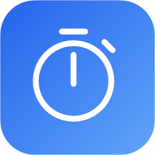
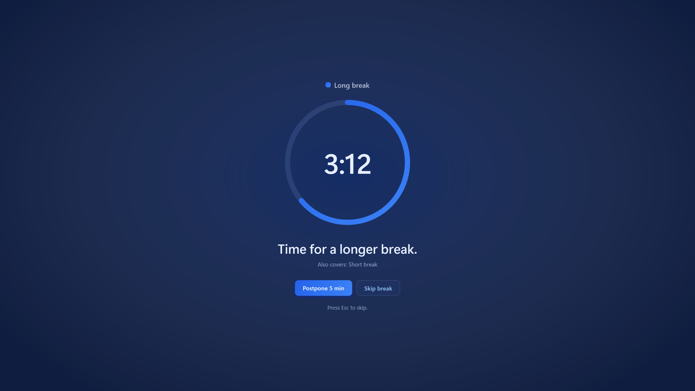
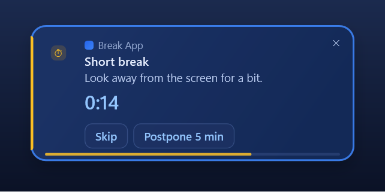
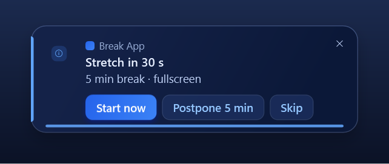
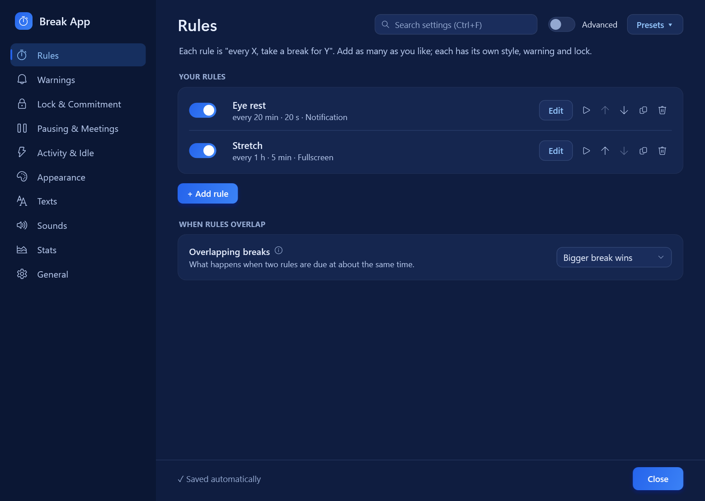
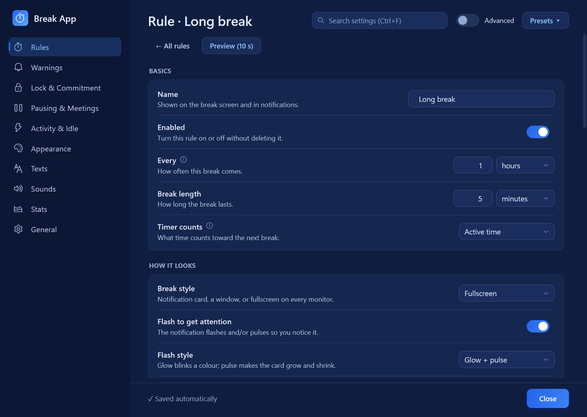
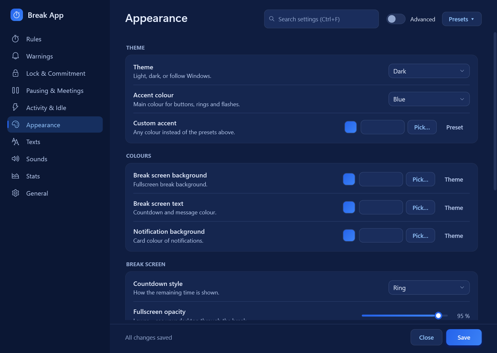
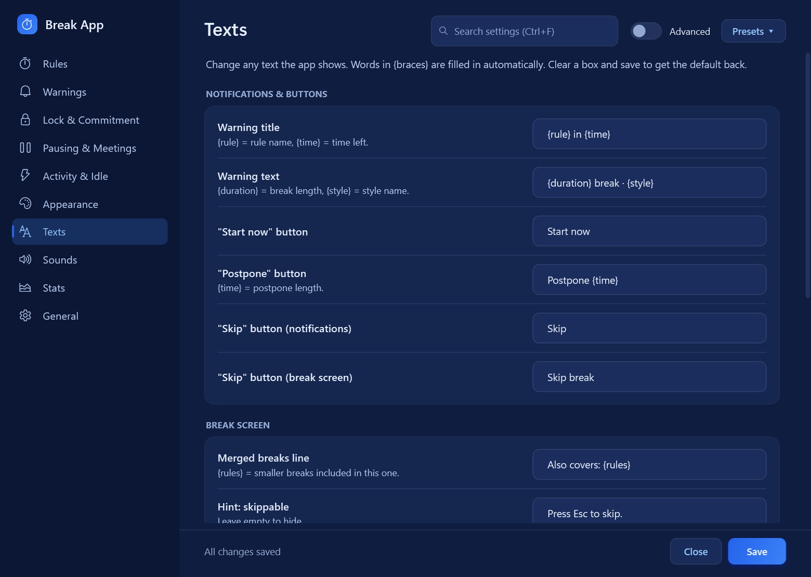
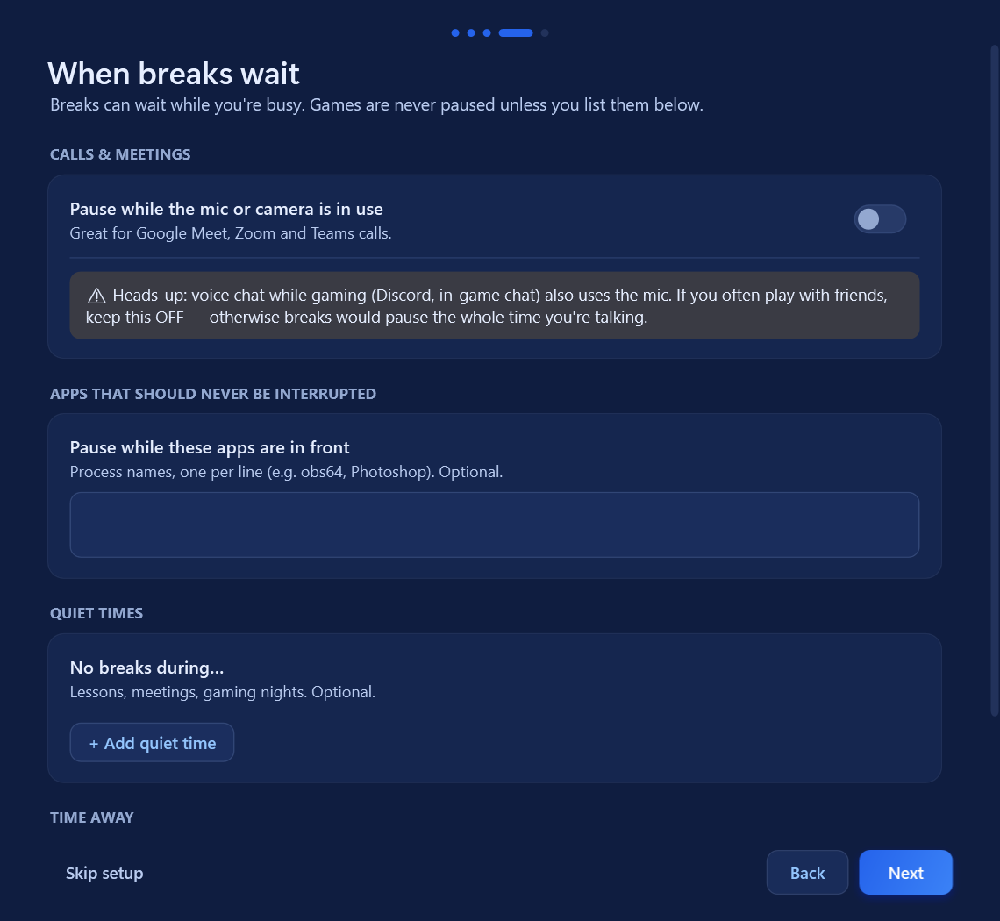
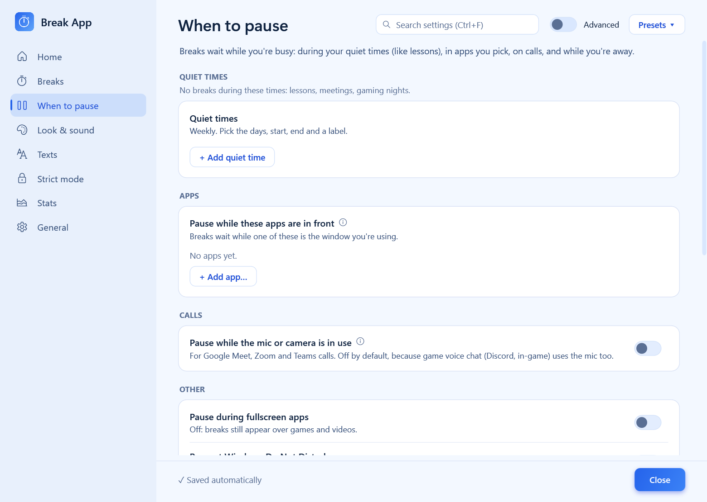

<div align="center">



# Break App

**A break reminder for Windows that does what you set it to.**
Short and long breaks on your own schedule, as a small notification or a full-screen break, easy to skip or properly locked.




</div>

> [!NOTE]
> **This project is maintained by Claude** (Anthropic's AI), **with human review.** Code, tests and docs are written by Claude; the owner reviews, tests and decides what ships. Commits and issue replies from Claude are marked as such.

---

## Why

Break App started because [Stretchly](https://hovancik.net/stretchly/) didn't fit. It couldn't be customized enough, and it was hard to turn off quickly when it got in the way. So this is a break reminder where you set everything yourself and can pause it in one click.

Break reminders are either too easy to ignore or too annoying to keep. Break App lets you decide exactly how each break behaves: a quiet card in the corner that pulses until you notice it, a fullscreen break that really locks your keyboard until the timer runs out, or anything in between.

It's a small native tray app (C# / WPF, ~0.6 MB exe). Stretchly is a good app and was the starting idea; Break App just goes its own way.

## Features

|  |  |
|---|---|
| ⏱️ **Unlimited break rules** | "Every X, break for Y." Each rule has its own style, warning, lock, sounds, messages and active hours. |
| 🕒 **Three timer modes** | *Active time* (only while you use the PC) · *clock time* · *fixed clock times* (:00, :20, :40…). |
| 🔔 **Notifications that get noticed** | A card in the corner with a live countdown that can **glow**, **pulse** (grow and shrink) or both. |
| 🖥️ **Window or fullscreen breaks** | Ring, bar or big-number countdown, on every monitor or just the ones you pick. |
| 🔒 **Real input lock** | *Locked*: keyboard and mouse are blocked (Alt+Tab and the Win key too) until you press your escape combo. *TOTAL LOCK*: no way out until the timer ends (asks "are you sure?" first). |
| ⚠️ **Warnings** | A heads-up before each break with **Start now / Postpone / Skip** (each optional). |
| ⏸️ **Smart pausing** | Quiet times (lessons, gaming nights), apps you never want interrupted, Do Not Disturb, manual pause, and optional call detection. |
| 🚶 **Natural breaks** | Time without input doesn't count toward the next break (the countdown pauses after 1 min of no input), and time away counts as a break. Gamepad input and watching videos count as activity. |
| 🤝 **Overlapping rules** | Bigger break wins, run both, or reset all timers. |
| 🧱 **Commitment mode** *(optional)* | No skipping, pausing or quitting shortly before strict breaks; making them weaker waits for a cooldown. |
| 🎨 **Customize almost everything** | Name your breaks and write their messages (Texts tab), every other text the app shows (with `{rule}`, `{time}`… placeholders), themes, any accent colour, break-screen colours, opacity, background image, text size, sounds, shortcuts, 12/24 h clock. |
| 📊 **Stats** | Breaks taken / skipped / postponed / natural per day and per rule, streaks, CSV export. |
| 🧭 **Setup guide** | A short first-run guide: preset, look, break times, pausing. Reopen it from the tray any time. |
| 🔄 **Updates** | Checks GitHub for a new version on start and once a day, then offers **Update now** (it never installs without a click). Turn it off in Settings › General. |

## Screenshots

<table>
<tr>
<td width="50%"><br/><sub>Notification break: live countdown, glow/pulse to get your attention</sub></td>
<td width="50%"><br/><sub>Warning before a break</sub></td>
</tr>
<tr>
<td><br/><sub>Rules: as many as you like</sub></td>
<td><br/><sub>Every rule is fully configurable</sub></td>
</tr>
<tr>
<td><br/><sub>Themes and colours</sub></td>
<td><br/><sub>Change any text the app shows</sub></td>
</tr>
<tr>
<td><br/><sub>First-run setup guide</sub></td>
<td><br/><sub>Light theme</sub></td>
</tr>
</table>

## Install

1. Install the [.NET 10 Desktop Runtime](https://dotnet.microsoft.com/download/dotnet/10.0) (x64) if you don't have it.
2. Download `BreakApp.exe` from the [latest release](../../releases/latest) and put it anywhere (e.g. `Documents\BreakApp`).
3. Run it. The **setup guide** opens on first launch; after that, Break App lives in the tray next to the clock.

After that you don't need to download it again: when a new version comes out, Break App shows a card with **Update now**. Your settings stay as they are.

Your settings and history are stored in `%AppData%\BreakApp\`. To uninstall, quit from the tray, turn off *Start with Windows* first (or delete the `BreakApp` value under `HKCU\Software\Microsoft\Windows\CurrentVersion\Run`), and delete the exe and that folder.

## Using it

- **Left-click / double-click** the tray icon → Settings. **Right-click** → take a break now, skip next, pause (15 min … until resumed), stats, setup guide, quit.
- The tray icon's ring shrinks as the next break gets closer; hover it for the exact time.
- **Settings** has 10 categories: Rules · Warnings · Lock & Commitment · Pausing & Meetings · Activity & Idle · Appearance · Texts · Sounds · Stats · General. Every setting has a short description and an ⓘ tip; changes **save automatically**; **Ctrl+F** searches all of them; **Advanced** shows the rarely used ones; **Presets** (Gentle · Balanced · Eye care · Strict) show exactly what will change before applying.
- Default shortcuts: **Ctrl+Alt+P** pause/resume, **Ctrl+Alt+B** take a break now, **Ctrl+Shift+Alt+B** end a *Locked* break early. All changeable.

## FAQ

**I play games with friends on voice chat. Will breaks keep pausing?**
Only if you turn on *Pause while the mic or camera is in use*. It's **off by default** for exactly this reason: Discord and in-game voice chat use the mic too. Turn it on if you mostly need it for work calls (Google Meet, Zoom, Teams).

**Do games pause my breaks?**
No, breaks still appear over games. If you want a specific game (or any app) to never be interrupted, add it under *Pausing & Meetings → Pause while these apps are in front* — click **+ Add app…** and pick it from the list of open apps.

**Can I always get out of a locked break?**
The lock is best effort and needs no admin rights. These always work, by Windows design: **Ctrl+Alt+Del** → Task Manager, admin windows that were already open, and UAC prompts. *Locked* breaks also end with your escape combo; *TOTAL LOCK* doesn't.

**Why does it want the .NET runtime?**
That keeps the exe tiny. Build with `-SelfContained` (below) if you prefer one bigger file with no runtime needed.

## Build from source

Requirements: Windows 10/11 and the [.NET 10 SDK](https://dotnet.microsoft.com/download/dotnet/10.0).

```powershell
git clone <this repo>
cd break-app
scripts\build.ps1                 # runs the tests, publishes dist\BreakApp.exe (needs the .NET runtime)
scripts\build.ps1 -SelfContained  # one bigger exe that runs without the runtime
scripts\run-ui-tests.ps1          # end-to-end self-test on a hidden desktop (nothing shows on your screen)
```

### Testing switches

| Switch | What it does |
|---|---|
| `BREAKAPP_FAST=1` (env) | Time runs 60× faster: a 20 min rule fires after 20 s. |
| `BREAKAPP_NO_AUTOSTART=1` (env) | Don't touch the Windows startup list. |
| `--demo-notification` / `--demo-break-notification` | Show a sample card, then exit. |
| `--demo-break window\|fullscreen\|locked\|total [seconds]` | Show a sample break. ⚠️ `locked`/`total` really lock input. |
| `--check-settings` | Headless check that every setting has a control in the UI. |
| `--self-test <report>` | 15 end-to-end scenarios (breaks, skip/postpone, pauses, settings, setup guide, commitment) with a scripted clock. Run it via `scripts\run-ui-tests.ps1`. |
| `--render-screenshots <dir>` | Render the README screenshots off-screen (default settings, nothing shown). |

Tray → **Diagnostics…** (Advanced mode) shows live idle time, gamepad / video / meeting / Do Not Disturb detection and every rule's timer.

### Project layout

```
src/BreakApp.Core   all decisions: settings, scheduler, pausing, commitment, history (no UI, 147 unit tests)
src/BreakApp        WPF shell: tray, notifications, break windows, input lock, OS signals, settings, setup guide, SelfTest.cs (15 end-to-end scenarios)
tests/              xUnit tests for Core
docs/               design spec, implementation plan, screenshots
```

## Report a bug or ask for a feature

Found a problem or have an idea? [Open an issue](../../issues/new/choose) and pick **🐞 Bug report** or **✨ Feature request**. For a bug, the last lines of `%AppData%BreakApppp.log` and a screenshot help a lot (remove anything private). Questions are welcome in [Discussions](../../discussions).

Issues are labelled by area (`area: breaks`, `area: lock`, `area: pausing`, `area: idle`, `area: settings`, `area: tray`, `area: ui/ux`) and `needs triage` until someone has looked at them.

Contributors: please read the [UX guidelines](docs/UX-GUIDELINES.md) before changing the UI, and run `scripts
un-ui-tests.ps1` before sending a change.

## License

[MIT](LICENSE)
